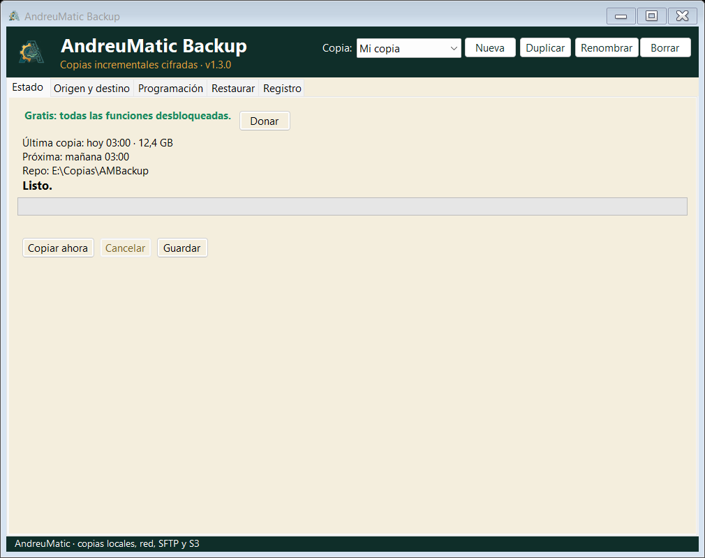
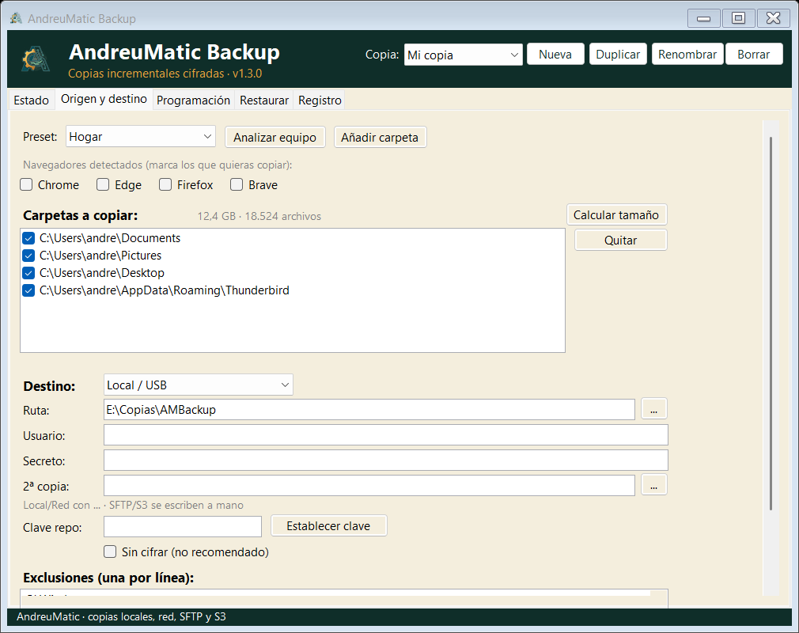
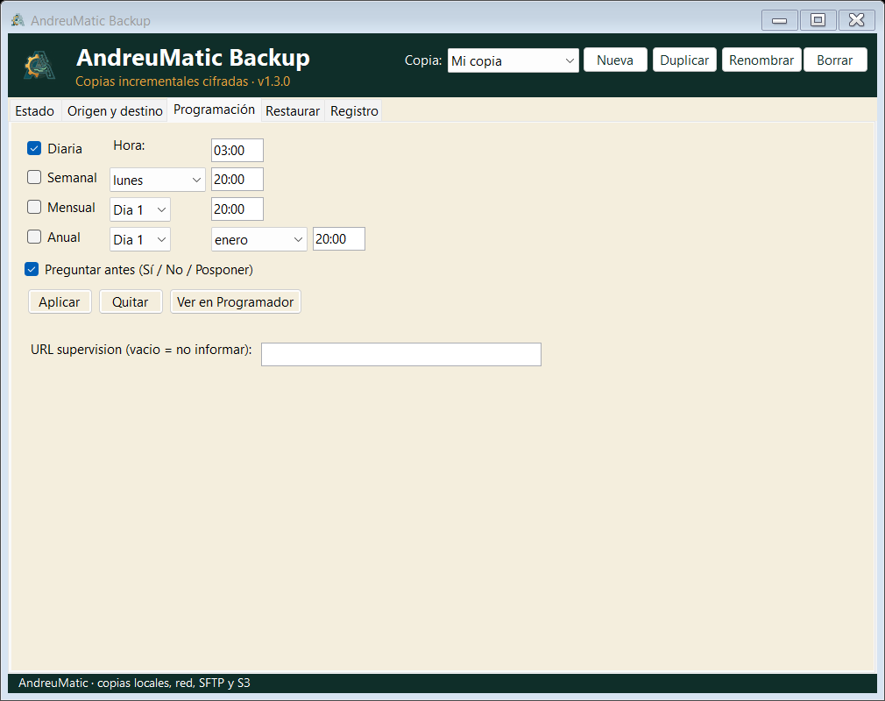
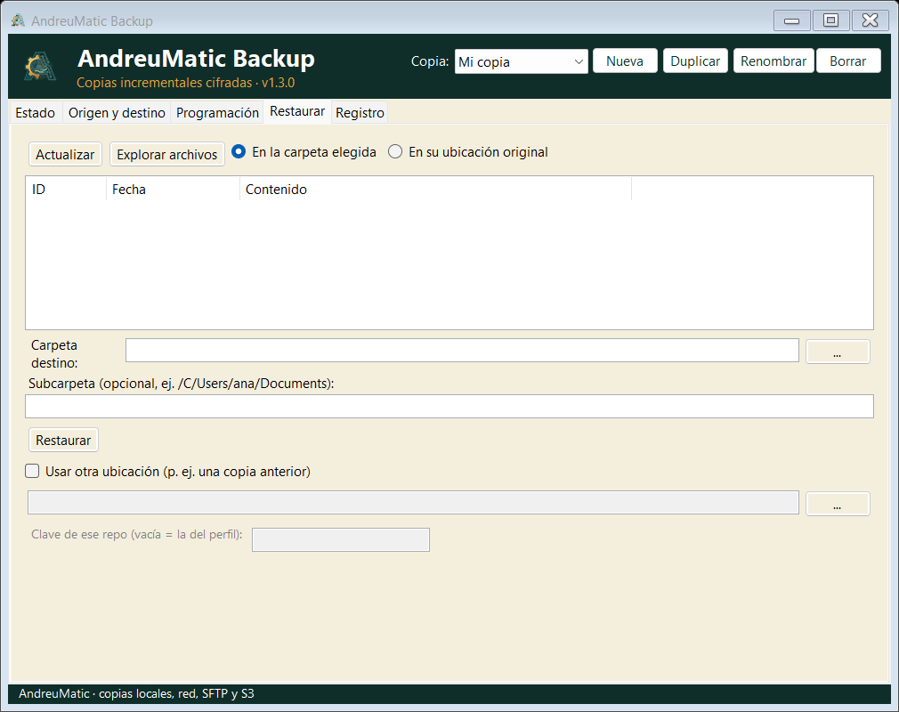

<div align="center">


# AndreuMatic Backup

**Copias de seguridad cifradas para Windows. Gratis, sin cuenta y sin cuotas.**

[](https://github.com/andreumatic/ambackup-releases/releases/latest)
[](https://ambackup.andreumatic.com/descargas)
[](https://ambackup.andreumatic.com/donaciones)
[](https://github.com/andreumatic/ambackup-releases/releases)
[](https://ambackup.andreumatic.com)

[Descargar](https://ambackup.andreumatic.com/descargas) · [Guía de uso](https://ambackup.andreumatic.com/guia) · [Donar](https://ambackup.andreumatic.com/donaciones)

</div>

---

## Qué es

Un programa de escritorio para Windows que hace **copias de seguridad reales** de tus
archivos: incrementales, cifradas y verificadas. Sin nube obligatoria, sin cuenta, sin
suscripción. Tú eliges dónde van las copias (disco externo, NAS, servidor SFTP o S3).

Por dentro usa [restic](https://restic.net/) como motor (incluido en el instalador), así
que la fiabilidad no depende de código propio: solo de la interfaz y de la programación.

## Capturas

| Estado | Origen de datos |
|---|---|
|  |  |
| **Programación** | **Restaurar** |
|  |  |

## Qué hace

- **Cifrado AES-256** con contraseña propia. Sin la clave, la copia no se puede leer.
- **Incremental con deduplicación**: la segunda copia ocupa solo lo que ha cambiado.
- **Programación** diaria, semanal, mensual o anual con el Programador de tareas de Windows.
- **Destinos**: disco local, USB, carpeta de red (SMB), SFTP y S3.
- **Segunda copia** opcional en otro destino (regla 3-2-1 sin complicaciones).
- **Verificación de integridad** de los datos ya guardados.
- **Retención** automática por días, semanas y meses.
- **Restauración** a la ubicación original o a otra carpeta, por fecha y con filtro de rutas.
- **Modo portable**: funciona desde un USB sin instalar nada.
- **Línea de comandos** para copias desatendidas.

## Descargar

| Archivo | Tamaño | SHA-256 |
|---|---|---|
| **[AMBackup-0.9.0.msi](https://github.com/andreumatic/ambackup-releases/releases/download/v0.9.0/AMBackup-0.9.0.msi)** — instalador | 47,05 MiB | `D8BBB7D73AC6876AF7FF7335EAEE3ED29CF9C0DD98A6CA9B17645AFB11E43C93` |
| **[AMBackup-0.9.0-portable.zip](https://github.com/andreumatic/ambackup-releases/releases/download/v0.9.0/AMBackup-0.9.0-portable.zip)** — portable | 64,64 MiB | `749148EE00CEE83735C0776180C7122240D1153D39711F6DD4AD185FF52CD1E3` |

Cada release incluye `SHA256SUMS.txt`. Para comprobar la integridad en Windows:

```powershell
certutil -hashfile AMBackup-0.9.0.msi SHA256
```

**Requisitos**: Windows 10 (1809 o superior) o Windows 11, 64 bits · 150 MiB libres.
restic va incluido: no hace falta instalar nada más.

### Instalador o portable

- **MSI**: se instala en `Program Files`, crea accesos directos y se desinstala desde
  *Aplicaciones*. Los datos viven en `C:\ProgramData\AndreuMatic Backup`.
- **Portable**: descomprime el ZIP donde quieras (por ejemplo un USB), ejecuta
  `AMBackup.exe`. Todo (perfiles, claves, registros y binarios) se queda **en esa carpeta**.
  No toca el registro ni deja rastro en el sistema.

### Aviso de SmartScreen

El instalador no está firmado con un certificado comercial, así que Windows puede mostrar
«Windows protegió tu PC». Pulsa **Más información → Ejecutar de todas formas**. Antes de
ejecutarlo puedes verificar el SHA-256 de la tabla de arriba.

## Primeros pasos

1. Instala (o descomprime el portable) y abre AMBackup.
2. Pulsa **Nuevo perfil**, ponle nombre y elige la **contraseña de cifrado**.
   *Guárdala: sin ella no hay forma de recuperar la copia.*
3. Añade qué carpetas copiar y el **destino** (disco, USB, red, SFTP o S3).
4. Pulsa **Copiar ahora** y revisa el registro. Después programa una hora.

Guía completa con capturas: **https://ambackup.andreumatic.com/guia**

## Restaurar

1. Abre la pestaña **Restaurar** y elige el perfil.
2. Selecciona la copia por fecha en la lista.
3. Escoge **al origen** o **a otra carpeta** (útil para mirar un archivo sin pisar nada).
4. Opcional: escribe rutas o patrones para restaurar solo una parte (`C:\Users\...\Documentos`).
5. Pulsa **Restaurar**. El registro indica cuántos archivos se han recuperado.

## Línea de comandos

```text
AMBackup.exe --backup "Nombre del perfil"    copia sin interfaz (para el Programador)
AMBackup.exe --avisar "Nombre del perfil"    avisa si la programación se ha saltado
AMBackup.exe --rutas                         muestra modo (instalada/portable) y carpetas
AMBackup.exe --hwid                          identificador de este equipo (soporte)
```

## Verificar una copia

La pestaña de cada perfil incluye **Verificar**. Ejecuta `restic check` sobre el repositorio
y avisa si algo no cuadra. También puedes hacerlo a mano con el `restic.exe` incluido en la
carpeta de la aplicación:

```powershell
.\restic.exe -r "D:\Copias\MiPerfil" check --read-data-subset=10%
```

## Versiones

| Versión | Fecha | Notas |
|---|---|---|
| 0.9.0 | 2026-10-26 | Restauración corregida, modo portable, tareas programadas más fiables, numeración 0.x |
| 1.3.0 | 2026-10-22 | Primera versión gratuita con todas las funciones |
| 1.2.0 y anteriores | 2026-09 | Serie con licencia por PC (retirada) |

Histórico completo: [Releases](https://github.com/andreumatic/ambackup-releases/releases) y [CHANGELOG](CHANGELOG.md).

## Código fuente

El código es **privado**. Este repositorio publica únicamente los binarios oficiales y sus
sumas de verificación, para que puedas comprobar que descargas exactamente lo que se compiló.

## Donaciones

El programa es gratis y no tiene versión «pro» ni límites ocultos. Si te ha salvado un día,
puedes invitar a un café por PayPal: **https://ambackup.andreumatic.com/donaciones**

## Licencia y terceros

AMBackup es software propietario de AndreuMatic; se distribuye **gratis** para su uso
personal y profesional, sin garantías. Consulta los
[términos de uso](https://ambackup.andreumatic.com/terminos).

Incluye [restic](https://github.com/restic/restic) (BSD-2-Clause) y sus dependencias; los
avisos completos van en `THIRD-PARTY-NOTICES.txt` dentro del instalador y del portable.

---

<div align="center">

Hecho en España por [AndreuMatic](https://andreumatic.com) · [info@andreumatic.com](mailto:info@andreumatic.com)

</div>
